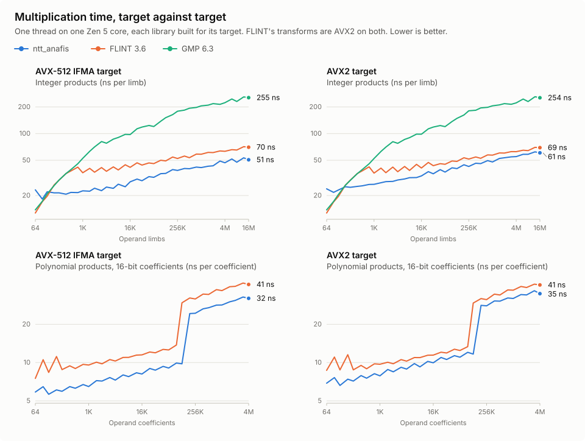

# NTTAnaFis

Exact multi-prime number-theoretic transforms for large integer and polynomial
products, in stable Rust.

`ntt_anafis` is a multiplication engine. It has no basecase or Karatsuba tower, so a
caller keeps its own for short operands and calls this crate above the crossover. It
also exposes its prime fields for modular algorithms.

- **Exact:** every admitted result is the exact integer, with no rounding error.
- **Portable:** vector kernels for x86, AArch64, s390x, LoongArch, POWER, and RISC-V,
  all on stable Rust, with `no_std` + `alloc` support.
- **Allocation-free path:** `MulPlan` runs entirely in caller-owned scratch.
- **Small:** one dependency, `core_anafis`, and Rayon with the `rayon` feature.

## Performance



Each library is built for its target and timed at its best, on one thread and identical
operands. FLINT's `fft_small` transforms are AVX2 on every x86 CPU, so AVX-512 IFMA is an
advantage only this crate has.

| Limbs | IFMA: `ntt_anafis` | FLINT | GMP | AVX2: `ntt_anafis` | FLINT | GMP |
| ---: | ---: | ---: | ---: | ---: | ---: | ---: |
| 256 | 5.4 µs | 7.6 µs | 7.5 µs | 6.7 µs | 7.6 µs | 7.6 µs |
| 1,024 | 23.0 µs | 36.7 µs | 53.5 µs | 29.1 µs | 36.3 µs | 53.1 µs |
| 16,384 | 461 µs | 676 µs | 1.6 ms | 591 µs | 664 µs | 1.6 ms |
| 262,144 | 9.9 ms | 13.6 ms | 46.3 ms | 11.6 ms | 13.5 ms | 47.0 ms |
| 1,048,576 | 42.9 ms | 60.6 ms | 215 ms | 51.3 ms | 59.9 ms | 215 ms |
| 16,777,216 | 844 ms | 1.17 s | 4.23 s | 1.09 s | 1.16 s | 4.21 s |

| Coefficients (16-bit) | IFMA: `ntt_anafis` | FLINT | AVX2: `ntt_anafis` | FLINT |
| ---: | ---: | ---: | ---: | ---: |
| 1,024 | 6.5 µs | 9.9 µs | 7.9 µs | 9.7 µs |
| 65,536 | 587 µs | 811 µs | 709 µs | 815 µs |
| 1,048,576 | 29.2 ms | 39.1 ms | 34.4 ms | 38.7 ms |
| 4,194,304 | 130 ms | 171 ms | 154 ms | 170 ms |

Shares below are of FLINT's time on the same target, as a median over the lengths measured:

- **AVX-512 IFMA:** integer products take 70% from 192 limbs (range 51–80%), and squares
  66% from 256 limbs (range 50–83%). At a million limbs, products take a fifth of GMP's
  time.
- **AVX2:** integer products take 88% from 256 limbs (range 70–99%), and squares 87% from
  384 limbs (range 70–101%). From three million limbs both are nearly level with FLINT,
  at 94–101%.
- **Polynomials, from 1,024 coefficients:** at 16 bits, where every FLINT coefficient
  stays inline, products take 74% with IFMA and 88% with AVX2. At 32 bits, where its
  results are bignums, they take 63% and 84%. Both curves step up near 131,072
  coefficients, where results outgrow one prime.
- **Short operands:** FLINT and GMP are faster below the crossover, through their
  basecase and Toom tower. This crate does not try to compete there.

These numbers come from one CPU: a Ryzen AI 7 350 on one Zen 5 core at 5.09 GHz, with
FLINT 3.6.0 and GMP 6.3.0 built by GCC 16. This CPU splits 512-bit operations in two, so
CPUs with full-width AVX-512 are unmeasured. The AVX2 target ran on this same core, and
other architectures have not been compared with FLINT.

## Usage

```toml
[dependencies]
ntt_anafis = "0.1"
```

Limbs are native words (`usize`), least significant first. A product of `a` and `b`
occupies exactly `a.len() + b.len()` limbs. Passing one slice as both operands runs the
cheaper square.

| Type | Use |
| :--- | :--- |
| `MulWorkspace` | Repeated integer products and squares, with retained tables and arenas |
| `MulPlan` | Integer products in caller-owned scratch |
| `ConvWorkspace`, `ConvPlan` | Exact convolutions of nonnegative coefficients, with the fewest primes that hold the caller's bound |
| `PrimeField`, `Residue` | Arithmetic modulo primes between `2^49` and `2^50` |
| `CrtPair` | Two-prime Chinese remaindering |

Repeated products reuse one workspace, whose tables serve every shorter transform:

```rust
use ntt_anafis::{MulPlan, MulWorkspace};

let (a, b) = (vec![42_usize; 1024], vec![7_usize; 1024]);
let mut dst = vec![0; a.len() + b.len()];

let mut workspace = MulWorkspace::new();
workspace.prepare(MulPlan::new(a.len(), b.len()).expect("admitted shape"));
assert!(workspace.mul(&mut dst, &a, &b));
```

A plan runs in scratch you own, and allocates nothing:

```rust
use ntt_anafis::MulPlan;

let (a, b) = (vec![u32::MAX as usize; 64], vec![0x1234_5678_usize; 48]);
let mut dst = vec![0; a.len() + b.len()];

let plan = MulPlan::new(a.len(), b.len()).expect("admitted shape");
let mut scratch = vec![0; plan.scratch_len()];
assert!(plan.mul(&mut dst, &a, &b, &mut scratch));
```

A polynomial product takes the largest coefficient of each operand. Each of the
`a.len() + b.len() - 1` result coefficients occupies `stride()` limbs:

```rust
use ntt_anafis::ConvPlan;

let (a, b) = ([1_usize, 2, 3], [4_usize, 5]);
let plan = ConvPlan::new(a.len(), b.len(), 3, 5).expect("admitted shape");
let mut dst = vec![0; plan.output_len()];
let mut scratch = vec![0; plan.scratch_len()];

assert!(plan.convolve(&mut dst, &a, &b, &mut scratch));
assert_eq!(dst, [4, 13, 22, 15]);
```

The prime fields stand alone:

```rust
use ntt_anafis::{CrtPair, PrimeField};

let mut catalog = PrimeField::catalog();
let (first, second) = (catalog.next().unwrap(), catalog.next().unwrap());

let (a, b) = (first.reduce(12345), second.reduce(12345));
assert_eq!(CrtPair::new(first, second).unwrap().combine(a, b), 12345);
```

## How It Works

- **Exact products in binary64:** residues are integer-valued `f64`. A fused
  multiply-add recovers the exact remainder of each product (Ogita, Rump, and Oishi 2005;
  van der Hoeven, Lecerf, and Quintin 2016). Targets without one use wrapping integers
  or Dekker's product (Dekker 1971).
- **Eight primes:** each lies between `2^49` and `2^50` and has roots of order at least
  `2^41`. Integer products use the prefix with the least estimated work. Convolutions use
  the fewest primes that hold the bound: one holds coefficients below `2^49`, two below
  `2^99`.
- **Rows of `2^k` and `3*2^k` points:** the second form splits `(x^N-1)(x^M-i)` with
  `N = 2M` in one remainder tree, which avoids the doubling past each power of two and
  needs no factor of three in `p-1`.
- **Cache-blocked stages:** radix-4 stages run down to fused 16-point leaves that stay in
  vector registers.
- **Unbalanced operands:** with one worker, a much longer operand runs in blocks that
  share one spectrum of the shorter operand.
- **Reconstruction:** cofactor Chinese remaindering adds each coefficient at its bit
  offset. AVX-512 IFMA evaluates eight coefficients at once in radix `2^52`; other
  targets evaluate one in radix `2^64`.

The proofs sit beside the code: residue bounds in `src/arch/contract.rs`, exact products
in `src/arch/scalar/product.rs`, and plan geometry in `src/profile/planner.rs`.
[AGENTS.md](AGENTS.md) maps the rest.

## Targets

| Target | Vector units | Lanes | Selection with `std` |
| :--- | :--- | :--- | :--- |
| `x86`, `x86_64` | AVX2 + FMA, AVX-512F, AVX-512 IFMA | 4, 8 | Run time |
| `aarch64` | NEON | 2 | Compile time |
| `s390x` | Vector facility, enhancements 1 | 2 | Run time |
| `loongarch64` | LSX, LASX | 2, 4 | Run time |
| `powerpc64` | VSX | 2 | Compile time |
| `riscv64` | V with `VLEN` of 128, 256, or 512 | 2, 4, 8 | Run time |

Other targets use portable scalar kernels. Without `std`, the target features select the
kernels at compile time. Rust 1.96 or later is required.

## Features

- **`std`** (default): run-time CPU detection.
- **`rayon`**: parallel transforms, packing, and reconstruction. An operation of about a
  thousand limbs or more enters the worker pool once, and smaller ones stay on the
  calling thread.

## Benchmarks

The `bench/` crate holds the benchmarks and their dependencies:

```sh
cargo bench -p ntt_anafis_bench
```

To reproduce the comparison above, build GMP, MPFR, and FLINT for the target under
`$PREFIX` (static libraries, FLINT with `--enable-avx2`). GMP 6.3 does not recognize
Zen 5, so pass it `--build` and `--host` of `zen3-pc-linux-gnu`. The benchmark first checks
that all libraries agree limb for limb:

```sh
# AVX-512 IFMA, with GMP and FLINT built by -march=native
RUSTFLAGS="-C target-cpu=native" REFERENCE_PREFIX=$PREFIX \
    cargo bench -p ntt_anafis_bench --features reference --bench reference

# AVX2 with kernels fixed at compile time, with GMP and FLINT built by -march=znver3
RUSTFLAGS="-C target-cpu=znver3" REFERENCE_PREFIX=$PREFIX \
    cargo bench -p ntt_anafis_bench --no-default-features --features reference --bench reference
```

## License

Apache License, Version 2.0.
